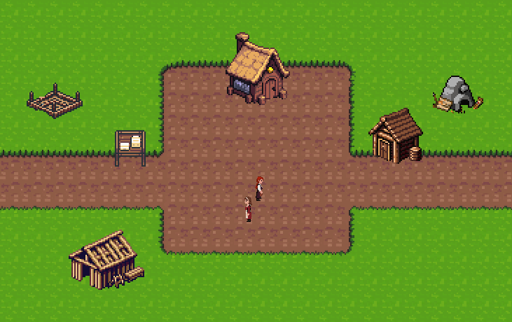
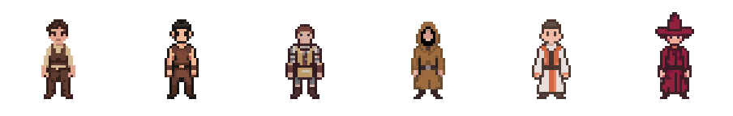

# HEAT

HEAT (Heroic Enterprise Adventure Time) is a browser game about running an adventuring business. It exists as a technical showcase: the game is deliberately simple, and the interest is in the data services behind it and the pipeline that delivers them.

## Play it

The game runs at [heat.dcg-games.com](https://heat.dcg-games.com). Sign in with a Google account; a new player gets a camp at Millbrook with one free villager to hire. A first session is hiring that villager, sending it to pick up sticks, then on a timber run, and building the mine with what comes back. Game balance is not a goal and the content is placeholder, on purpose (`docs/design/purpose.md`).

## What is being shown

Each line is a service problem that the game exists to make visible. The system is described in [docs/architecture/overview.md](docs/architecture/overview.md); the rules each part is written to are under [docs/standards/](docs/standards/).

- **An Angular 22 client, zoneless, with PixiJS inside components.** The page is Angular: panels, routing, signals, standalone components. The camp and the battle are a PixiJS scene inside one component, never the whole display ([docs/standards/angular.md](docs/standards/angular.md)).
- **A GraphQL hub on one Lambda function.** Apollo Server through its Lambda integration, a Pothos code-first schema with the printed schema committed and checked for staleness, and field-level authorization through scopes ([docs/standards/graphql.md](docs/standards/graphql.md)).
- **DynamoDB and S3, nothing relational, nothing in a VPC.** Two single-table designs, one per partition key: the player table, private and read only through the hub, and the location table, public. Replays are one object each in S3.
- **Cognito for sign-in**, Google through the pool's managed login on the environment's own `auth.` hostname, the authorization code grant with PKCE in the browser, a JWT authorizer on the API.
- **A deterministic engine the server verifies.** The hub issues a seed and a frozen snapshot of the party at start; the browser runs the engine and submits only its override log; the hub replays it from the same seed and settles the result in one transaction. One version per deploy, and the previous deploy stays live beside it to verify the adventures it issued.
- **Terraform applied only by the pipeline.** Every working branch gets a running stack at `<issue>.heat-sb.dcg-games.com` on its first push, destroyed with the branch; a merge to `main` applies `dev`; a merge to `release`, through a pull request that carries the `prod` plan, applies `prod`. The pipeline assumes OIDC roles under a permissions boundary, a resource-type allow-list and a budget action; plans are posted on the pull request ([docs/process/deployment.md](docs/process/deployment.md), [terraform/](terraform/)).
- **Generated art with its provenance.** Every sprite set under [art/](art/) carries the service, the prompts, the ids and the rights beside the frames ([docs/process/assets.md](docs/process/assets.md)).

## How it is built

The project is built by one person directing coding agents, and the history is meant to be read that way: agents write nearly all of the code and documents, a person reviews and merges.

- Every change is a pull request, reviewed and merged by the owner; nothing reaches `main` or `release` otherwise ([docs/process/code-changes.md](docs/process/code-changes.md)).
- The owner and an agent work under written rules: say when an idea is bad, be candid about what was not done, work conflicts out in conversation, and the owner decides ([docs/process/collaboration.md](docs/process/collaboration.md)). In security and platform management, best practice first, checked against current documentation rather than recalled ([docs/process/best-practices.md](docs/process/best-practices.md)).
- The standards are numbered rules, so that a review finding, an issue and a document cite a rule by number. Lint at the strictest published tiers is the floor; a model reviews each pull request against the standards from a session that did not write it; the whole tree is checked at pauses ([docs/standards/](docs/standards/), [docs/runbooks/](docs/runbooks/)).
- Every significant choice has a decision record with what was considered and not chosen ([docs/decisions/](docs/decisions/README.md)).

## Status

The platform and the core loop, steps 1 and 2 of the build order in [docs/architecture/overview.md](docs/architecture/overview.md), are in production: a player can sign in, hire, run adventures, build and lose heroes. Issues remain open on both. Step 3, the shared camp with other players' heroes and recent adventures at a location, is next. The open issues are the whole backlog.

## Read next

| Want to know | Read |
| --- | --- |
| Every project document, and how documents are written | [docs/README.md](docs/README.md) |
| What the player does | [docs/design/game.md](docs/design/game.md) |
| The system: services, data, flows, build order | [docs/architecture/overview.md](docs/architecture/overview.md) |
| Why a choice was made, and what was rejected | [docs/decisions/](docs/decisions/README.md) |
| How a change is run and seen before review | [docs/process/development.md](docs/process/development.md) |
| Each stack: what it manages and whether it is applied | the README in each directory under [terraform/](terraform/) |
| How an agent starts a session here | [AGENTS.md](AGENTS.md) |

## Rights

All rights reserved. The repository is published to be read.
