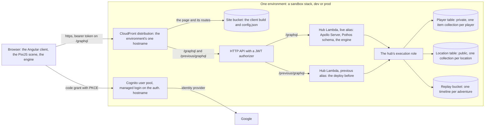
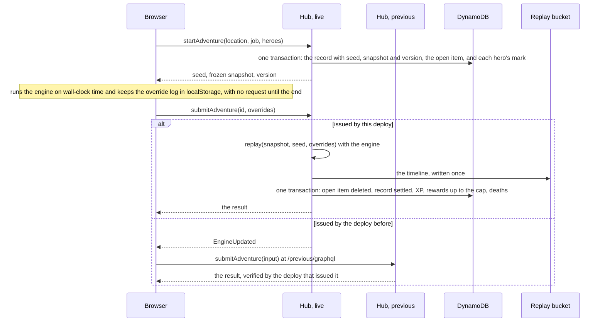
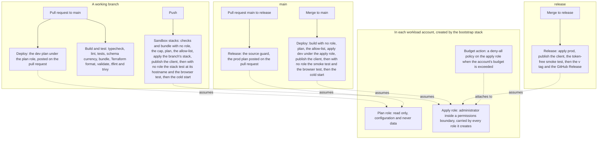

# Architecture

How the system delivers the game described in `docs/design/game.md`: services, data, and the flows between them. The platform and the core loop, steps 1 and 2 of the build order at the end of this document, are built and run in production at `heat.dcg-games.com`; an item marked **Built** names the issue that built it, and each stack's README under `terraform/` says whether it is applied. Everything else here is design to build to, with the status its item carries.

## The shape in three diagrams

Each diagram draws the system as of commit `1d2a55c` on `main`, 2026-11-02. The prose below is the authority where they differ.

**The system.** One environment, whether a branch's sandbox stack, `dev` or `prod`: the browser reaches one hostname, sign-in goes through Cognito to Google, every request for data goes through the hub, and the hub is the only identity that reads or writes the tables and the replay bucket.

**The adventure loop.** The server issues the seed and a frozen snapshot, the browser plays and submits only its override log, and the deploy that issued the adventure replays it and settles the result in one transaction (decisions 0014 and 0030).

**The pipeline.** Terraform is applied by the workflows and by nothing else; a branch's stack is created by its first push, and production is reached only through a pull request to `release` (decisions 0017, 0018 and 0021).

Each item carries a status. **Decided** items are settled by the project owner. **Working assumption** items were proposed during design and not yet objected to: build on them, but expect them to be revisited. **Open** items are not yet answered.

## Services and data

- **Decided.** GraphQL with field-level authorization.
- **Decided.** Search and browse: a sample of other players' heroes at my location, walking about my camp; which adventures other players recently completed here; view a replay.
- **Decided.** Amazon Cognito for sign-in.
- **Decided.** Player-private data and public game data are kept apart: separate tables with separate access roles, and every request for private data goes through the GraphQL hub, which is where authorization is answered. (Restated 2026-10-14 from "nothing private goes into DynamoDB or S3": the intent was always the separation, not the choice of store.)
- **Decided.** A reporting pipeline comes after the rest is further along, not first.
- **Decided.** The hub is one TypeScript Lambda function behind the HTTP API: Apollo Server through its Lambda integration, a Pothos code-first schema, and the scope-auth plugin for field-level authorization. It is the only API for core requests and the one place authorization is enforced. It imports the engine as a library (decision 0012). Lambdas serve everything; there is no container anywhere.
- **Decided (decision 0038).** The API's shape, `docs/standards/graphql.md` rules 4 to 6: every id the hub issues is `ID` and every timestamp `DateTime`; every set the engine closes is an enum, `UPPER_CASE` on the wire and the engine's own string inside the hub and past the client's API boundary; a mutation takes one input object, `input: <MutationName>Input!`, and answers a result union of `<MutationName>Success`, wrapping what it changed, and one object type per refusal, each an `Error` with its message and the fields the client needs, so a refusal is data the client reads by `__typename`; the `errors` array keeps what is not the game's business, the codes rule 6 lists; every root field is nullable. Built in Issue-155 (`packages/hub/src/refusals.ts`, `@pothos/plugin-errors`, `graphql-scalars`), with the client and the stack test reading the unions and the two lint rules that express the shape no longer held back. A change of the wire shape itself, which this was, is the one case the two routes of decision 0030 cannot bridge: an adventure open across that deploy cannot be submitted to the previous route, which speaks the old shape, until the next deploy moves that route to the new one, and is then discarded (decision 0038).
- **Decided (decision 0039).** Every boundary is checked by a library: the contract's scalars say what a type can (`UUID`, `NonNegativeInt`, `PositiveInt`), zod through `@pothos/plugin-validation` says the rest of an input's shape before any resolver runs, and zod reads the hub's environment and the client's `config.json`, so a verb receives input of the right shape and checks only what depends on what it read. Built in Issue-198, and in Issue-206 for the last variable, `HEAT_REPLAY_BUCKET`.
- **Built (Issue-156).** The client of decision 0012: its operations are `.graphql` files, one definition per file, generated by GraphQL Code Generator's client preset into typed documents and types from the committed schema (`codegen.mjs`, `npm run codegen`), committed and checked current by "Build and test" as the schema is, and linted against the schema, so a document the hub would refuse fails before it is pushed. Apollo Angular sends them: `packages/client/src/app/hub.ts` builds the link chain that carries the token, the version header, the `outdated` flag and the previous deploy's route, and `Game` watches the player's query, reads it again after every mutation, and derives every view from the generated types with the engine's sets read back at its boundary (`docs/standards/angular.md`, rules 4 and 5).
- **Decided.** No relational store. All data is in DynamoDB and S3, and no function runs inside a VPC (decision 0013).
- **Decided.** The browser signs in with Google through the pool's managed login on `auth.<zone name>`, with the authorization code grant and PKCE performed by `oidc-client-ts` against the stack's own public app client, whose refresh tokens rotate; the API's JWT authorizer validates the tokens (decision 0024, Issue-46). A sandbox stack's login page also offers email and password, for the base's test users, so that an agent signs in without Google (Issue-86); `dev` and `prod` are Google only. The client learns the stack it runs in from `config.json`.
- **Working assumption.** Data ownership:

  | Data | Store | Written by |
  | --- | --- | --- |
  | Players; per location, the camp, own facilities and resources; heroes; the materials ledger; the open-adventure item | DynamoDB, the player table | the hub |
  | Adventure records: status, the player's id, which only the hub reads (decision 0043), seed, the version that issued it, the location, the job, the frozen snapshot of the party, the start time, and at settlement the result; later the location feed, the heroes seen there, offers and shared projects | DynamoDB, the location table | the hub at start and at submit |
  | Replay timelines, one object per adventure, `<adventureId>.json`, stamped with the version that wrote it | S3, a private bucket per environment, read through the hub | the hub at submit |
  | Static content: unit types, jobs, abilities, locations with their shared facilities and recruitment lists, facility levels and caps, hero names, the sprite sets each unit type allows | the engine package, as TypeScript data | the repository; imported by the client and the hub |

  Two tables, each named for its partition key (decision 0023): the player table, one item collection per player, private and read only through the hub; the location table, one collection per location and the adventure records by id, public in what the API serves from it (decision 0043). Both exist from the first sandbox stack, and start and settle write to both in one transaction. The location view (step 3) adds the feed of recent adventures to the location's collection and one index for replays by job (decision 0050; `docs/architecture/camps.md`). Every new access pattern is designed as a key or an index before its feature is built; an entity growing richer or a new item type costs no table change, a new partition key would.

- **Working assumption.** The flow:
  1. **Start.** The hub checks that the job is on the location's board and that every hero of the party is the player's, alive and at that camp; issues the seed and the frozen snapshot of the party, stamped with the deploy's version; and writes the adventure record, the open-adventure item and each hero's mark of the adventure it is on in one transaction. Built in Issue-113.
  2. **Play.** The browser runs the engine and collects overrides. No request is made between start and submit.
  3. **Submit.** One request. The hub replays the override log from the snapshot and seed with the engine, writes the timeline to the replay bucket, and settles: one transaction clears the open-adventure item, marks the record settled with the result, credits XP to the heroes and the rewards to the ledger up to the warehouse's cap, and records the deaths, every write conditional, so a repeated submit cannot pay twice (decision 0014). The response carries the result. Built in Issue-114 (`docs/architecture/adventure-loop.md`).
  4. **Replay.** The client reads the stored timeline through the hub, `adventure(id)` with its `timeline` (Issue-114), and plays it back. The timeline is display only and needs no engine, so any version of the client plays it. Any settled adventure, anyone's, plays the same way on its own page, `/replays/<id>`, reached from the job board's recent adventures and a job's replays (Issue-290).
- **Decided.** The engine advances on a clock its caller drives. The browser feeds it wall-clock time; the hub feeds it the next event, so verifying a ten-minute adventure takes milliseconds. No timer inside the engine waits for real time. Checked 2026-10-21 against BattleScript Online's engine before the port: its stepping reads no clock, and its one wall-clock read, a timestamp on the outcome, is dropped in the port.
- **Working assumption.** Private causes, such as which facility granted a bonus, are resolved by the hub at start into the snapshot's effective numbers and are never recorded in the timeline.
- **Working assumption.** The engine is one TypeScript package in this repository, used by both the Angular client and the hub.
- **Decided.** The hub's cold start, measured on 2026-10-17 on the first sandbox stack (`heat-sb38`, Issue-38), the first request after the deploy: 627 ms of initialization, then 234 ms for the request itself; warm requests about 50 ms; 127 MB used of 1024; arm64; a 4.1 MB unminified bundle holding the SDK, Apollo, Pothos and Powertools, with tracing active. Acceptable for a game request, so nothing is bought: no provisioned concurrency. The levers if it grows: minify the bundle, leave the source map out of the zip, trim imports. Reported on every deploy in the run summary, from the function's log after the stack test, so the number is watched rather than remeasured.
- **Built (Issue-201, decisions 0041 and 0042).** The repository, `packages/hub/src/db/repository.ts`, is the only caller of DynamoDB and is made of ElectroDB: one entity per item type in `db/entities.ts`, whose key templates are the `TEMPLATES` of `db/keys.ts`, the one statement of the layout. The tables were made whole by a backfill in the pipeline, removed by Issue-213.

## The adventure loop

This section is its own document, `docs/architecture/adventure-loop.md`: the seed and the frozen snapshot the server issues at start, the override log the browser submits, one version per deploy with the previous deploy kept live to verify what it issued, what start, submit and discard write, how the client plays, resumes and replays, and what verification proves.

## Camps, heroes and resources

This section is its own document, `docs/architecture/camps.md`: the player table's keys, the hero's item, the recruit, retire, build and settle transactions, and the location table's keys for the heroes seen at a location, recent adventures and replays by job (decisions 0026, 0029 and 0050).

## Live location channel

- **Decided.** An API Gateway WebSocket API with one Lambda function serving connect, disconnect and default by route key, a Lambda authorizer on `$connect` that verifies the Cognito token, which travels in the query string or the subprotocol header because browsers cannot set headers on a WebSocket, and a DynamoDB table of connections per location. The channel carries the live feed of completed adventures and canned actions; the hub pushes through the gateway's callback API. Verification results do not travel here: they return in the submit response (decision 0014). The direction recorded on 2026-10-08, that Lambdas serve the live channel but not the core requests, is superseded by decision 0012.

## Engine provenance

The turn machinery is adapted from the author's earlier private project, BattleScript Online (`bso-game-shared/src/combat/`), in Issue-110: the engine that the caller steps to the next event, the seeded random number generator, charge timers, abilities with tags and reach by line, the event timeline, and overrides stamped in simulated time, with their tests. Left behind, by decision 0030: player-authored behavior sets, status effects, mana and resource pools, traits, equipment, skill trees, quests, presentation cues, and the grid's rows. The outer loop of stages, carry-over, cargo, retreat and the stage time limits is new (Issue-112), as is replaying an override log, which the earlier project designed and did not build. Resource nodes as obstacles, harvested by a unit's gather rating against a node's difficulty, are new too (Issue-283, decision 0051). Files that are copied or adapted say so in their header.

## Environments

What exists and what is still to be built is in the build order below; each stack's README says whether it is applied.

- **Decided.** Four AWS accounts, owned by the Double Cobra Games organization and placed by it: `heat-platform` for Terraform state; `heat-sandbox` for the per-issue sandbox stacks; `heat-dev` and `heat-prod` for the two permanent environments. The organization layer, in the `dcg-platform` repository, enrolls them in Control Tower, applies the organization's controls to them, and places in each workload account a `PlatformAdminRole` that only `heat-platform` may assume. Everything inside the accounts beyond that role is HEAT's. There is no container registry (decision 0012). All four accounts exist; `heat-sandbox` was created by the organization layer on 2026-10-16.
- **Decided.** Every stack keeps its state in `heat-platform`, in one S3 bucket with one key per stack and environment (decision 0008). The `backend` and `bootstrap` stacks run from `heat-platform` under the owner's session and reach the workload accounts through `PlatformAdminRole`. An environment is applied by HEAT's own apply role in its workload account, which the bucket's policy lets read and write its own keys (decision 0017).
- **Decided.** Account ids are not committed. Stacks take the account id as a variable, from an ignored file on the owner's machine or from the repository's GitHub Actions secrets in the pipeline (`docs/README.md`, rule 9; decision 0035).
- **Decided.** The pipeline applies Terraform, and Terraform owns the function code: each function's zip is passed with its hash, every change publishes a version, and the alias follows the version, so a change that needs a table, a permission and code is one plan. A push to a working branch applies that branch's sandbox stack; a merge to `main` applies `dev`; a merge to `release`, through a pull request that carries the `prod` plan, applies `prod`, and the workflow then writes a date-based `v*` tag and a GitHub Release as documentation (decision 0021). A pull request to `main` carries the `dev` plan, run under the `dev` environment with its real values (decision 0020). Workflows assume roles through GitHub's OIDC provider: in each workload account a read-only plan role for the pull requests' plans and a bounded apply role, both HEAT's own, created by the `bootstrap` stack. The apply role is an administrator under a permissions boundary that allows only the services the shape uses, denies outright the ones that cost money while idle, and is carried by every role an environment creates; a plan-time allow-list of resource types fails the run on anything else; the account budget attaches a deny-all policy to the apply role when exceeded; every apply's plan is in the run summary (decisions 0017 and 0019). The plan role is read only and sees configuration, never data; the agent assumes it from its audit chain to plan a change before pushing it. The code artifacts are one bundle per function and the browser client (decision 0012).
- **Decided (decision 0030).** One version per deploy, the commit the workflow deployed, written by Terraform into the hub's environment and by the publish step into `config.json`, so the client and the hub of one deploy carry the same version. Built in Issue-113: every workflow job that runs Terraform sets `TF_VAR_app_version` from `github.sha`; the environment module sets `HEAT_VERSION` on every function and returns `app_version`, which `scripts/publish-client.sh` writes into `config.json` as `version`. Every deploy republishes the hub, even a client-only one, and moves `live`; a second alias, `previous`, keeps the deploy before it, reachable at a second route behind the same authorizer and integrated with that alias, so an adventure started under the previous deploy is verified by the code that issued it (`docs/architecture/adventure-loop.md`). Built in Issue-114: `previous` learns what `live` was from data sources read when Terraform plans (`terraform/modules/environment/previous.tf`): whether the function exists yet, then the function at `live` with its `HEAT_VERSION`; a deploy of another commit moves `previous` to `live`'s version, a re-run or re-plan of the same commit leaves it where it is, and a stack's first apply points both aliases at its one version. The same read gives the function `HEAT_PREVIOUS_VERSION`. The route is the manifest's `POST /previous/graphql`, naming the alias, behind the same authorizer, and the site's distribution sends it to the API like `/graphql`. A sandbox stack has the alias like any environment, which is the test that two versions can be live at once; the stack test reads the version from both routes. The replay bucket, `<prefix>-replays`, private, TLS only, is the one object store beside the sites' buckets, and the hub's role may put and get its objects and nothing else.
- **Decided.** Every working branch has a sandbox stack, `heat-sb<issue>`, named from the issue number in the branch name, created by the push at the branch's creation, re-applied on every push, destroyed when the branch is deleted and by a weekly sweep of orphans, under a cap of 5 concurrent stacks (`.github/workflows/sandbox.yml`, `docs/process/development.md`). A permanent `sandbox-base` root, applied from `main` under its own GitHub environment, holds what the stacks share: the zone `heat-sb.dcg-games.com`, one certificate for the zone name and its wildcard, validated through the zone (Issue-39), one Cognito user pool with its managed login domain, `auth.heat-sb.dcg-games.com` (`terraform/modules/login-domain`; `auth.heat-dev.dcg-games.com` and `auth.heat.dcg-games.com` for the permanent environments), Google as its identity provider through one Google OAuth client per pool (Issue-46), a password-flow app client for end-to-end tests, and test users that the apply job creates from a committed list. Each stack adds a browser app client to that pool with its own callback URLs (decision 0018 and its amendments).
- **Decided.** One hostname per environment, which is a CloudFront distribution: `<issue>.heat-sb.dcg-games.com` per sandbox stack, `heat-dev.dcg-games.com` and `heat.dcg-games.com`. The distribution serves the client from its bucket through origin access control, routes `/graphql` to the environment's HTTP API and, once the live channel exists, the socket's path to its WebSocket API, so the browser has one origin and the APIs have no hostname of their own. A CloudFront Function serves the page for the client's routes; the apply job publishes the build and a `config.json` of the stack's facts into the bucket, so one build serves any stack. No load balancer (decisions 0010, 0015 and 0018; `terraform/modules/site`, Issue-39).
- **Decided.** Nothing emulates AWS. The system runs in a sandbox stack; the fast loop on the laptop is the engine's unit tests and the hub's data-layer tests against DynamoDB Local started by Testcontainers, with no AWS credentials. Every AWS call still goes through an SDK client whose endpoint is configuration, which is what lets those tests point at the container, and every Lambda is a plain function (decision 0009 as amended by 0018). For display work the Angular dev server runs locally against a stack, signing in through the stack's app client with a localhost callback. The emulator was removed in Issue-38; `docs/process/development.md` describes the loop.
- **Decided.** Non-secret per-environment configuration is written by Terraform: into the functions' environment variables for the runtime, and into Parameter Store under `/heat/<stack>/` (`site_url`, `api_url`, `user_pool_id`, `browser_client_id`, `login_host`, and `app_client_id` where the pool has a `ci` client, which `prod` does not) for whatever calls the stack, and into the site's `config.json` for the browser; the repository holds names, never per-environment values. Runtime secrets, if any, are injected from Secrets Manager into the runtime and never cross a laptop or a log. The serverless shape needs none today: Cognito, DynamoDB and S3 are reached under the function's role.
- **Decided.** Infrastructure secrets, today the pool's Google client secret and the test users' password, live in the GitHub environment of the deployment they belong to and enter AWS through that account's base root, as Terraform variables under the environment. Where the resource is a secret store, the value is written with a write-only argument and never enters state; where the resource needs the raw value, it is in that root's state, which the same identities could read from the service anyway. Environment roots never take a secret value. The one exception to "never cross a laptop" is a git-ignored copy of the sandbox base's secrets for local plans (decision 0020). One repository secret, `HEAT_E2E_HANDOVER_KEY`, carries a test user's password between two jobs of a run and never enters AWS (decision 0046).
- **Working assumption.** No VPC in any environment. Every function runs outside a VPC and reaches AWS services over their public endpoints under its role.
- **Decided.** The Terraform stacks in this repository: `backend` (applied); `bootstrap`, one root per account (applied in all three on 2026-10-16), creating the plan and apply roles and the budget with its action; `sandbox-base`, one root composing the `base` module, the first stack the pipeline applies (Issue-37; its README says whether it has been); `environment`, with a root per permanent environment, `dev` (Issue-40; applied by `deploy.yml` on every merge to `main`, followed by the smoke test of `scripts/e2e.mjs` through `https://heat-dev.dcg-games.com`) and `prod` (Issue-41; applied by `release.yml` on every merge to `release`, followed by the token-free half of the same test through `https://heat.dcg-games.com`, because prod's pool has no password-flow client and no test users), each composing the `base`, `environment` and `login-domain` modules, and one root for every sandbox stack, `terraform/environment/sandbox`, which takes the issue number as a variable and its state key from `scripts/sandbox.mjs` (Issue-38, applied by `sandbox.yml`). The permanent roots have their state key written into their backend block, and applying one is entering its directory with no flag selecting anything (decision 0016, amended by 0018 for the sandbox root). The resources live in modules under `terraform/modules/`. Never Terraform workspaces, which share one backend and are not an isolation mechanism. Each stack's README says what it manages and whether it is applied.
- **Working assumption.** The functions are the hub, the WebSocket handler and its authorizer. Each is an entry in the manifest, bundled on its own with the shared packages compiled in; there are no layers (`docs/standards/typescript.md`, rule 12). Each runs on arm64 with its memory and timeout from the manifest, logs JSON lines through the Powertools logger, emits metrics through Powertools as embedded metric format lines in that log, under middy with the Powertools middlewares (decision 0040), traces through X-Ray with its SDK calls captured, and holds an execution role under the boundary with the least it needs; the HTTP API is throttled per environment and its access log shows what the authorizer refused. In `dev` and `prod`, three alarms per function, on errors, throttles and duration, the hub's `ConflictAnswered`, and each table's `TransactionConflict` and `ConditionalCheckFailedRequests` notify an SNS topic with the owner's address subscribed; a sandbox stack has none (`terraform/modules/environment`, Issue-40 and Issue-199).

## Build order

**Working assumption:**

1. Platform, in this order: the pipeline's plan and apply roles per account with their guardrails (Issue-36, done); the sandbox base, the zone and the pool with its test users, and the workflow's plan-and-apply path (Issue-37); the environment module proven on a per-issue sandbox stack, with the emulator removed and the cold start measured (Issue-38), beside the Angular client skeleton with a home page (Issue-45); a site per stack with the wildcard certificate (Issue-39); sign-in with Google from the home page (Issue-46); `dev` through the pipeline (Issue-40); `prod` through the release branch (Issue-41).
2. Camp and core loop, in this order (decision 0026): the camp's art; the camp scene with the heroes hall and the free villager; start, play, submit and replay from the job board, which brings in the first resources, split on 2026-10-21 into the design (Issue-109), the battle engine (Issue-110) beside the monsters' art (Issue-111), the adventure engine (Issue-112), the hub's start (Issue-113), the hub's submit (Issue-114) beside the job board panel (Issue-115), and the client's play (Issue-15); then paid recruitment and the roster. Retirement needs no resources and came ahead of the job board (Issue-98). Added on 2026-11-10, before any more gathering jobs: resource nodes as obstacles with gather ratings per resource (Issue-283); a ranged unit on each side, the ranger and a goblin rock thrower, with their art (Issue-284, Issue-286); the miner and the lumberjack, with theirs (Issue-285, Issue-287).
3. The shared camp, in this order (Issue-282, decision 0050): other players' heroes walking about, built in step 2 (Issue-100, Issue-114); the hub's recent adventures at a location, built (Issue-288); the hub's replays by job, built (Issue-289); the client's lists and a page that plays any settled replay, built (Issue-290); the lumber camp's first job, after the node rework (Issue-291); then the design of more locations, how they unlock, caravans and the caravan hub's jobs (Issue-292), whose build issues are filed when it is agreed.
4. Live feed and canned actions.
5. Cooperation.
6. Reporting pipeline.

## Open

- The keys that more locations and caravans need, designed before they are built (decision 0013), in Issue-292. The camp's and the heroes' keys are designed (decision 0026), and so are the heroes seen at a location (decision 0029) and recent adventures and replays by job (decision 0050).
- A player's own history of adventures: its key in the player table, designed with its feature (decision 0050).
- Step 5's shared facilities that players contribute to: their items under the location, and how upkeep fits a game with no real-time gating.
