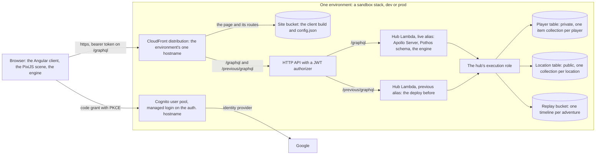
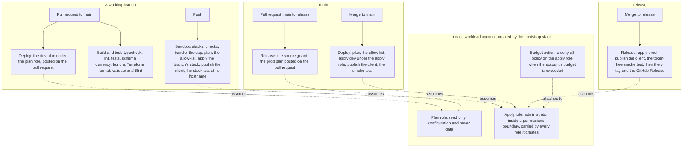

# Architecture

How the system delivers the game described in `docs/design/game.md`: services, data, and the flows between them. The platform and the core loop, steps 1 and 2 of the build order at the end of this document, are built and run in production at `heat.dcg-games.com`; an item marked **Built** names the issue that built it, and each stack's README under `terraform/` says whether it is applied. Everything else here is design to build to, with the status its item carries.

## The shape in three diagrams

Each diagram draws the system as of commit `1d2a55c` on `main`, 2026-11-02. The prose below is the authority where they differ.

**The system.** One environment, whether a branch's sandbox stack, `dev` or `prod`: the browser reaches one hostname, sign-in goes through Cognito to Google, every request for data goes through the hub, and the hub is the only identity that reads or writes the tables and the replay bucket.



**The adventure loop.** The server issues the seed and a frozen snapshot, the browser plays and submits only its override log, and the deploy that issued the adventure replays it and settles the result in one transaction (decisions 0014 and 0030).

```mermaid
sequenceDiagram
  participant B as Browser
  participant H as Hub, live
  participant P as Hub, previous
  participant D as DynamoDB
  participant S as Replay bucket
  B->>H: startAdventure(location, job, heroes)
  H->>D: one transaction: the record with seed, snapshot and version; the open item; each hero's mark
  H-->>B: seed, frozen snapshot, version
  Note over B: runs the engine on wall-clock time and keeps the override log in localStorage; no request until the end
  B->>H: submitAdventure(id, overrides)
  alt issued by this deploy
    H->>H: replay(snapshot, seed, overrides) with the engine
    H->>S: the timeline, written once
    H->>D: one transaction: open item deleted, record settled, XP, rewards up to the cap, deaths
    H-->>B: the result
  else issued by the deploy before
    H-->>B: ENGINE_UPDATED
    B->>P: submitAdventure(id, overrides) at /previous/graphql
    P-->>B: the result, verified by the deploy that issued it
  end
```

**The pipeline.** Terraform is applied by the workflows and by nothing else; a branch's stack is created by its first push, and production is reached only through a pull request to `release` (decisions 0017, 0018 and 0021).



Each item carries a status. **Decided** items are settled by the project owner. **Working assumption** items were proposed during design and not yet objected to: build on them, but expect them to be revisited. **Open** items are not yet answered.

## Services and data

- **Decided.** GraphQL with field-level authorization.
- **Decided.** Search and browse: a sample of other players' heroes at my location, walking about my camp; which adventures other players recently completed here; view a replay.
- **Decided.** Amazon Cognito for sign-in.
- **Decided.** Player-private data and public game data are kept apart: separate tables with separate access roles, and every request for private data goes through the GraphQL hub, which is where authorization is answered. (Restated 2026-10-14 from "nothing private goes into DynamoDB or S3": the intent was always the separation, not the choice of store.)
- **Decided.** A reporting pipeline comes after the rest is further along, not first.
- **Decided.** The hub is one TypeScript Lambda function behind the HTTP API: Apollo Server through its Lambda integration, a Pothos code-first schema, and the scope-auth plugin for field-level authorization. It is the only API for core requests and the one place authorization is enforced. It imports the engine as a library (decision 0012). Lambdas serve everything; there is no container anywhere.
- **Decided.** No relational store. All data is in DynamoDB and S3, and no function runs inside a VPC (decision 0013).
- **Decided.** The browser signs in with Google through the pool's managed login on `auth.<zone name>`, with the authorization code grant and PKCE performed by `oidc-client-ts` against the stack's own public app client, whose refresh tokens rotate; the API's JWT authorizer validates the tokens (decision 0024, Issue-46). A sandbox stack's login page also offers email and password, for the base's test users, so that an agent signs in without Google (Issue-86); `dev` and `prod` are Google only. The client learns the stack it runs in from `config.json`.
- **Working assumption.** Data ownership:

  | Data | Store | Written by |
  | --- | --- | --- |
  | Players; per location, the camp, own facilities and resources; heroes; the materials ledger; the open-adventure item | DynamoDB, the player table | the hub |
  | Adventure records: status, seed, the version that issued it, the location, the job, the frozen snapshot of the party, the start time, and at settlement the result; later the location feed, the heroes seen there, offers and shared projects | DynamoDB, the location table | the hub at start and at submit |
  | Replay timelines, one object per adventure, `<adventureId>.json`, stamped with the version that wrote it | S3, a private bucket per environment, read through the hub | the hub at submit |
  | Static content: unit types, jobs, abilities, locations with their shared facilities and recruitment lists, facility levels and caps, hero names, the sprite sets each unit type allows | the engine package, as TypeScript data | the repository; imported by the client and the hub |

  Two tables, each named for its partition key (decision 0023): the player table, one item collection per player, private and read only through the hub; the location table, one collection per location and the adventure records by id, public. Both exist from the first sandbox stack, and start and settle write to both in one transaction. The location view (step 3) adds the location collections and one index for replays by job. Every new access pattern is designed as a key or an index before its feature is built; an entity growing richer or a new item type costs no table change, a new partition key would.

- **Working assumption.** The flow:
  1. **Start.** The hub checks that the job is on the location's board and that every hero of the party is the player's, alive and at that camp; issues the seed and the frozen snapshot of the party, stamped with the deploy's version; and writes the adventure record, the open-adventure item and each hero's mark of the adventure it is on in one transaction. Built in Issue-113.
  2. **Play.** The browser runs the engine and collects overrides. No request is made between start and submit.
  3. **Submit.** One request. The hub replays the override log from the snapshot and seed with the engine, writes the timeline to the replay bucket, and settles: one transaction clears the open-adventure item, marks the record settled with the result, credits XP to the heroes and the rewards to the ledger up to the warehouse's cap, and records the deaths, every write conditional, so a repeated submit cannot pay twice (decision 0014). The response carries the result. Built in Issue-114 (below).
  4. **Replay.** The client reads the stored timeline through the hub, `adventure(id)` with its `timeline` (Issue-114), and plays it back. The timeline is display only and needs no engine, so any version of the client plays it.
- **Decided.** The engine advances on a clock its caller drives. The browser feeds it wall-clock time; the hub feeds it the next event, so verifying a ten-minute adventure takes milliseconds. No timer inside the engine waits for real time. Checked 2026-10-21 against BattleScript Online's engine before the port: its stepping reads no clock, and its one wall-clock read, a timestamp on the outcome, is dropped in the port.
- **Working assumption.** Private causes, such as which facility granted a bonus, are resolved by the hub at start into the snapshot's effective numbers and are never recorded in the timeline.
- **Working assumption.** The engine is one TypeScript package in this repository, used by both the Angular client and the hub.
- **Decided.** The hub's cold start, measured on 2026-10-17 on the first sandbox stack (`heat-sb38`, Issue-38), the first request after the deploy: 627 ms of initialization, then 234 ms for the request itself; warm requests about 50 ms; 127 MB used of 1024; arm64; a 4.1 MB unminified bundle holding the SDK, Apollo, Pothos and Powertools, with tracing active. Acceptable for a game request, so nothing is bought: no provisioned concurrency. The levers if it grows: minify the bundle, leave the source map out of the zip, trim imports. Reported on every deploy in the run summary by the stack test, so the number is watched rather than remeasured.

## The adventure loop

The design is `docs/design/game.md`, "The adventure loop" and "The battle"; the first cut's shape is decision 0030.

- **Decided.** The server issues the seed and a frozen snapshot of the party at start, so a client cannot choose its seed. The snapshot holds each hero's id, unit type, name, sprite set, level and effective stats, and the job by its id; the job's stages, the monsters and the abilities are read from the static content by the version that issued the adventure, which is the only version that verifies it.
- **Decided.** The browser submits only its override log: each entry the simulated time it was accepted, the unit it is for, and the override. The hub regenerates the timeline, so the stored replay is always produced by the server.
- **Decided.** One version for the whole app, client, hub and engine: the commit the workflow deployed, written into the function's environment and into `config.json` (decision 0030). An adventure is stamped with it at start. The current deploy verifies only its own version; the deploy before it stays live beside it (see "Environments"), reachable at a second route, and verifies the adventures it issued. A submit of another version is refused with `ENGINE_UPDATED` and the current version; the client then tries the previous route, and the same refusal there means the adventure is too old: the client asks the hub to discard it, which clears the open item and marks the record discarded, crediting nothing, and tells the player. So an adventure survives one deploy and not two. On `prod` that is two releases back to back; on `dev` two merges, which is ours to live with.
- **Decided.** The client sends its version on every request, and every response says when it differs from the hub's. The client reloads itself to the new deploy, at once with no adventure open and otherwise once the adventure is over, waiting until the result is shown, so a player mid-adventure when a deploy lands finishes on the client they loaded and submits to the previous route; a reload, not a prompt, by the owner's call on Issue-115. A tab reloads away from a version only once, so a page still outdated after its reload, as when `config.json` and the hub are briefly out of step during a deploy, stays as it is rather than reloading in a loop. A push over the live channel comes with the channel.
- **Decided.** The engine's own clock and stages. Every fight and gather stage carries its own time limit in the job's content; reaching it ends the adventure as a retreat, so no run can stall (game.md, "The battle"). The engine stamps the timeline with a schema version; a change to the events' shape is a migration of stored timelines or a "replay unavailable", decided when it happens.
- **Decided.** Determinism is a property within one version, and every adventure is fixed to one: the engine's test is that a run stepped by wall-clock time and the replay of its override log stepped event by event produce the same timeline and result. Nothing watches for a change to the timeline across versions, because nothing is ever verified across them; a replay is a log of what the verifying version did, and makes no decisions of its own.
- **Working assumption.** The one-adventure rule is one conditional item per player in DynamoDB. Starting an adventure puts it if absent, or returns the one already open. Settlement deletes it in the same transaction that credits rewards. Proven in the spike under concurrent starts.
- **Built (Issue-112).** The adventure engine in `packages/engine/src/adventure/`: `AdventureEngine` runs a job's stages on one clock with the battle engine's stepping API, each fight and gather a `CombatEngine` seeded `<seed>#<stage>` with its events shifted onto the adventure's clock; the party orders, press on and retreat, in the one override log beside the forced actions, an order stamped at the step that took it up; a retreat attempted in a fight with its own seeded generator and certain at a stage's end; and `replay(snapshot, seed, overrides)`, which returns the timeline, stamped with its schema version, and the result settlement reads. The snapshot (`AdventureSnapshot`), the jobs, the retreat rule and the XP threshold table (`LEVEL_XP`, `levelForXp`) are in the engine; the battle engine gained a retreat hook and a carry limit. The determinism test steps both jobs by wall-clock frames with clicks and orders and checks `replay` of the log gives the same timeline and result.
- **Built (Issue-113).** Starting, `startAdventure(location, jobId, heroIds)` in `packages/hub/src/start.ts`: an open adventure refused with `ADVENTURE_OPEN`, its id in `extensions.adventureId`; the job on the location's board (`NO_SUCH_JOB`); one to four heroes (`PARTY_SIZE`), each the player's (`NOT_YOUR_HERO`), at that camp (`HERO_NOT_HERE`), alive (`HERO_DEAD`, `HERO_RETIRED`) and on no adventure (`HERO_ADVENTURING`). The snapshot is the engine's `AdventureSnapshot`, its stats the unit type's, since levels add none yet and there are no picks; the seed and the id are random UUIDs. One transaction puts the open-adventure item if absent and the record (location, job, snapshot, version, start time, seed, status) if new, and marks each hero with the adventure's id on the condition that it is alive, at the location and on no adventure, so a racing start, retire or death fails one side; a start that loses reads again and answers with the open adventure or the hero's reason. `retireHero` refuses a marked hero with `HERO_ADVENTURING`, as a condition in its transaction too; the owner's rule of 2026-10-22. `Adventure` exposes the location, the `job`, the typed `snapshot` and the `version`, and `me.openAdventure` reads the record. The deploy's version is `HEAT_VERSION` on the function and `version` in `config.json` ("Environments"); a request whose `heat-version` header names another version gets `extensions.outdated: true` on its response, errors included, and one without the header is not flagged. Proven by data-layer tests of every refusal, of concurrent starts with shared and separate heroes, and of a start racing a retire; the stack test starts "Wolves on the mill road" with the villager and checks the open adventure and its version against `config.json`, the refusals and the flag, then settles through the spike's `settleAdventure`, which now clears the party's marks, until Issue-114 replaces it.
- **Built (Issue-114).** Submitting, `submitAdventure(adventureId, overrides)` in `packages/hub/src/submit.ts`: another player's adventure is `NO_SUCH_ADVENTURE`; a settled one answers as it is, so a repeat pays nothing and still gets the result; a discarded one is `ADVENTURE_DISCARDED`; one issued by another version is `ENGINE_UPDATED` with the hub's version in `extensions.version`. The log comes in as flat `OverrideInput` entries, checked into the engine's entries (a hero of the party, a whole-millisecond time, at most 2,000), and replayed with `replay` from the record's snapshot and seed; a log that differs from the one the replay keeps is logged, not refused, because a client resumed with a newer engine submits one honestly and the issuing version's replay is the result either way. The timeline goes to `<prefix>-replays` as `<adventureId>.json` with `If-None-Match: *`, so it is written once; a submit that finds one stored, from a submit that lost its transaction or raced this one, replays that timeline's log instead, so the record's result and the stored replay always agree. Settlement then reads the camp, its holdings and the party and writes, in one transaction (`Repository.settle`): the open item deleted on its adventure id; the record `SETTLED` with its result and time on the condition that it is open; the camp's warehouse level checked against the one the cap came from, and its living count decremented by the dead on the condition that it covers them; each survivor's XP and its level from `LEVEL_XP`, never lowered, its mark removed and its sighting refreshed; each dead hero `DEAD` on the condition that it was alive, its mark removed and its sighting deleted; each holding written with its credit up to `warehouseCapacity` on the condition that its balance is the one read; one ledger entry per material, `LEDGER#<adventureId>#credit#<material>`, with the credit and what the cap lost. A balance or the warehouse that moved in between is read again, three times at most, then `CONFLICT`. The result on the record and the response: the outcome, each stage's ending, the rewards, what was credited and what was lost, and each hero's XP gained, XP, level, health and death. Discarding, `discardAdventure(adventureId)` in `packages/hub/src/discard.ts`: one transaction deletes the open item, marks the record `DISCARDED` on the condition that it is open and the caller's, and removes the party's marks, crediting nothing; an adventure that this deploy or the previous one issued is refused with `ADVENTURE_VERIFIABLE`, because it can still be submitted and a discard would undo its deaths (the owner's rule of 2026-10-22); the previous deploy's version reaches the function as `HEAT_PREVIOUS_VERSION` ("Environments"). `adventure(id)` answers a settled adventure to any signed-in player, for its replay, and an open or discarded one only to its own; its `timeline`, a `JSON` scalar, is read from the bucket. `version` answers the route's deploy. The spike's `settleAdventure` and the engine's `rewardsForSeed` are gone. Proven by data-layer tests with the bucket in memory (`MemoryTimelines`), the S3 store by the stack test: a completed job, a repeated and a racing submit, the cap part full and full, a balance moved between the read and the write, a death, `ENGINE_UPDATED`, a stored timeline that wins, and the discard's refusals and its close. The stack test plays "Timber from the near woods", because a lone villager loses "Wolves on the mill road" on every seed (Issue-126).
- **Built (Issue-115).** The client's start, in `packages/client/src/app/`. The job board is its own panel, `/camp/<location>/job-board`, listing the jobs the location's board posts with their pay; a job's detail, `/camp/<location>/job-board/jobs/<id>`, says its stages in order, what it credits, each beside the camp's balance of that resource and the room left under the warehouse's cap, and its retreat penalty in words (`camp/panels/job-words.ts`), then picks one to four of the camp's living heroes in no order, and Depart calls `startAdventure` and goes to `/adventure`; a refusal is shown in place under Depart, in the player's words for each code. `/adventure` shows the open adventure's job and party from its snapshot, and sends the address to the camp when none is open; the header bar's "Adventure in progress" and an entry at the end of the facility menu, with `art/icons/adventure.png`, lead there while one is open. Every request carries `heat-version` from `config.json`'s `version`, which the client now requires, and `Updates` (`updates.ts`) reloads the page on a response flagged `outdated`, as above.
- **Built (Issue-15, the play).** The client plays the open adventure at `/adventure`, a route loaded on first use. `AdventureRun` (`packages/client/src/app/adventure/run.ts`) runs the engine from the record's snapshot and seed, stepped by wall-clock time at 1×, 2× or 4× and paused at will (`play.ts`), and keeps the override log off the engine's own events, `action-overridden` and `order`, so the log it submits is the one the engine keeps. Each hero's unit type's action list is its force buttons, a forced action shown as queued until the hero's next turn uses or drops it; press on and retreat are the party's orders; a stage's last ten seconds are counted down. The log and the time reached are saved in `localStorage` under `heat.adventure.<id>` whenever the log grows and every simulated second; a run with a saved log steps event by event to the saved time, handing each entry in before the step that reaches it as `replay` does, and plays on, and one without starts again from the same seed. At the end the client submits the log to `/graphql`, on `ENGINE_UPDATED` to `/previous/graphql`, and on `ENGINE_UPDATED` there too discards it and says it was lost to a game update (`Game.submitAdventure`); a failure to reach the hub keeps the log and offers to try again. The result takes the controls' place: each stage's ending, the rewards and what the cap lost, each hero's XP and any level gained, the dead, and Back to camp. The player is read again at once, and a waiting reload (`Updates`) holds until the player leaves the result. A hero on the adventure is kept out of the camp scene, and the warehouse's panel lists the camp's stock against its cap, so the settlement shows. The second pull request of Issue-15 draws it: the battle scene of decision 0028's amendment, the clock held at each entry while the scene brings everyone on, and the replay, which reads the timeline through the hub (`Game.timeline`) and plays it in the same scene with the same pause and speeds, with no engine (`TimelineRun` in `run.ts`).
- **Decided.** Resuming replays the override log so far up to the saved point with the client's own engine, whatever version issued the adventure; the result is whatever the issuing version verifies at submit. The log in progress is kept in the browser's storage, keyed by the adventure id. If it is lost, the run restarts from the beginning with the same seed.

### What verification proves

The client holds the seed, so a modified client can try override sequences offline and submit the best one. Verification proves that the outcome is reachable under the rules with that seed. It does not prove that a person played it live. Closing that gap would mean the server revealing randomness stage by stage, which is the per-step traffic this design avoids.

## Camps, heroes and resources

The design is `docs/design/game.md`, "Locations and camps", "The heroes hall" and "Resources"; the key shapes and their reasons are decision 0026.

- **Decided.** The player table's keys, all in the player's one item collection, so the camp loads with one Query of `PLAYER#<id>`:

  | Sort key | Item |
  | --- | --- |
  | `PROFILE` | the player |
  | `AT#<location>#CAMP` | the camp: hall and warehouse levels, the counts of active and of living heroes, kept by every transaction that changes them (recruit and retire so far); no item means the starting location at level 1 with no heroes |
  | `AT#<location>#FACILITY#<kind>` | an own facility the camp builds and its level, absent until built; the hall's and the warehouse's levels are on the camp's item (decision 0032) |
  | `AT#<location>#HOLDING#<resource>` | a resource balance at that location |
  | `HERO#<heroId>` | a hero, with its location as an attribute, and the open adventure's id while it is on it |
  | `LEDGER#<causeId>#<entry>` | append-only; the cause is an adventure id, a hero id or a build, `build-<location>-<kind>-<level>`, and the entry can exist once |
  | `OPEN` | the one open adventure |

- **Decided.** A hero's item: unit type, sprite set and name, chosen by the hub at recruitment and never by the client; location; recruited at; level, XP and the stat-boost picks (the choices, not the resulting numbers, so they survive a change to the stat tables); weapon and its fights left; status, alive, dead or retired, and when it retired; the open adventure it is on, set at start and cleared at settlement, while it is on one; history counters. Fields a later feature adds default in code.
- **Decided.** Recruiting is one mutation, `recruitHero(unitType, requestId)`, and one transaction: the camp's active count below the hall's cap, then incremented; one conditional debit and one ledger entry per resource in the cost, or none for a villager when the camp's count of living heroes is zero, which the condition checks; the hero item put if absent. The request id becomes the hero id, so a repeated request fails its condition and returns the hero already made. The hub draws the sprite set and then a name that suits its label (masculine, feminine or either; game.md, "Heroes") from the static content with a cryptographic random source, avoiding names on the camp's living roster.
- **Decided.** The profile is made on first sign-in by `joinGame`, which the client calls after every sign-in: one update that writes the profile if absent and leaves it alone if present. Nothing else creates a profile. A Cognito trigger is not used: every sandbox stack shares one user pool (decision 0022), so a trigger cannot know which stack's table to write, and the trigger after sign-up fires once per user, not once per stack.
- **Built (Issue-81).** The keys above for the camp, the hero, the holdings and the ledger; `joinGame`; `recruitHero` for the free villager, with the cap and the free-villager rule as conditions on the camp's counts, proven by data-layer tests under concurrent recruits and repeated requests; the player's camps and heroes on `me`, owner-only; the static content of Millbrook, the first location, in `packages/engine/src/content.ts`. The stack test recruits the free villager and checks that a second is refused. The client (Issue-81, second pull request): the header bar with the location select and the open adventure; `joinGame` after every sign-in; the camp scene in PixiJS (decision 0028) with the ground, the hall, the job board and the warehouse, and the living heroes walking about; the hall's roster and the free villager, who walks out of the hall; a hero's card on a click. The page's regions (Issue-89, `docs/design/game.md`, "The page"): the facility menu with its icons, the persistent content area with the panel as a child route of the camp (`/camp/<location>/<facility>`, `/camp/<location>/heroes-hall/heroes/<id>`, `packages/client/src/app/app.routes.ts`), each panel its own component under `camp/panels/`, the narrow-screen order, and the scene filling its box around Millbrook's 400×225 map, in `packages/client/src/app/camp/`, with the arithmetic in `page-layout.ts`. Millbrook lists a mine, a lumber camp and a caravan hub as `buildableFacilities` in the engine's content, each with its description in `FACILITIES`; they stand at level 0 until built (Issue-93).
- **Built (Issue-98).** Retiring is one mutation, `retireHero(heroId)`, and one transaction, `packages/hub/src/retire.ts`: the hero's status set to retired, with the time, on the condition that it is still the status read, alive or dead; the camp's active count decremented, and its living count too if the hero was alive, on the condition that neither goes below zero. A concurrent retire, death or move fails the hero's condition, so the counts change once; a recruit that read the camp before a retire fails its own condition on the counts. A hero already retired is answered as it is. Retiring the only living hero makes the next villager free. A hero on the open adventure cannot retire (Issue-113). Proven by data-layer tests under concurrent retires and a retire racing a recruit for the last slot; the stack test retires its villager and recruits the free villager again on a sandbox stack. The client: a Retire button on an active hero's card, behind a confirmation in place; a retired hero's card says when it retired and offers nothing; the hall's roster lists the retired apart, collapsed; and a retired hero walks back into the hall and leaves the scene.
- **Built (Issue-82).** Paid recruitment and the roster. `recruitHero` recruits any unit type on the location's list at its hall level, `Repository.recruit` in `packages/hub/src/db/repository.ts`: one transaction puts the hero, counts it into the camp on the condition that the hall is at the level read and below its cap, debits each resource of the cost on the condition that the balance covers it with a ledger entry `LEDGER#<heroId>#debit#<material>` that can exist once, and puts the sighting. The price is one rule in the engine, `recruitCost`, which the hub charges and the hall shows: a villager is free when the camp has no living hero and costs its price otherwise, and only the villager's transaction holds the living count, zero for a free one and above zero for a paid one, so a death or a recruit between the read and the write cannot change what was charged. Refusals: `HALL_LEVEL`, `HALL_FULL`, `INSUFFICIENT_RESOURCES` with `extensions.short` (each material's amount and the camp's balance), `BAD_USER_INPUT`, and `CONFLICT` only when a lost race is explained by no rule; a request that loses a race reads the camp again and is refused with the rule that now fails. Proven by data-layer tests of two recruits for the last slot, two for the timber of one, a paid recruit racing a retire for the last slot, a repeated paid request, and a paid fighter with ore put into the holdings directly, since no job yields ore until Issue-133. The stack test asks for a fighter and is refused for want of ore, and after the timber run recruits a paid villager for 20 timber and retires it, on every stack. The client: the hall's roster grouped living, dead and retired, the retired collapsed; every recruit the location offers, its price beside the camp's balance, and why it cannot be had; the hub's refusal shown in place on the recruit it refused.
- **Built (Issue-99).** Heroes in the camp scene are drawn at half the scene's scale, rounded up (`heroScale` in `packages/client/src/app/camp/page-layout.ts`; decision 0028, as amended by Issue-99): the canvas renders at the scene's scale, each hero on a whole canvas pixel, walking at its own art pixels' pace.
- **Working assumption.** A caravan with passengers takes a slot at the destination in the start transaction, conditional on a free slot there, and settlement releases one of the two slots by the outcome. A party is validated at start from the camp's living heroes.
- **Built (Issue-93, decision 0032).** Building and upgrading a facility is one mutation, `buildFacility(location, kind, level)`, naming the level being built, so a repeat finds it built and is answered with the camp, charging nothing (`packages/hub/src/build.ts`). One transaction, `Repository.build`: the facility's level set to the next on the condition that it is still the level read, each facility the level needs checked at its level or above, and each resource of the cost debited on the condition that the balance covers it, with a ledger entry `LEDGER#build-<location>-<kind>-<level>#debit#<material>` that can exist once. The hall's and the warehouse's levels are on the camp's item, which the recruit and settle transactions already condition on; every other own facility is its own item, `AT#<location>#FACILITY#<kind>`, absent until built. The costs, levels and prerequisites are `FACILITIES` in the engine's content, and the reason a level cannot be built is one engine rule, `buildRefusal`, which the hub checks and the panel shows. Refusals: `BAD_USER_INPUT`, `MAX_LEVEL`, `REQUIRES` with `extensions.missing`, `INSUFFICIENT_RESOURCES` with `extensions.short`, `CONFLICT`. The camp answers each facility's level on `Camp.facilities`. Proven by data-layer tests of five concurrent builds of one level, two builds for the timber of one, a stale level, a stale balance, a hall upgrade racing a recruit and a requirement held in the transaction. The stack test builds the mine once its test user's camp can pay, and checks that a repeat charges nothing and that the mine has no second level. The client: a build section in each own facility's panel and in the hall's, and the scene swapping a facility's picture when its level changes.
- **Built (Issue-133).** A job names the facility that posts it, `facility` in the engine's `Job`, or none for the job board; `jobsPostedBy(location, poster)` is the one rule for which jobs a poster lists, which the panels show. The first is the mine's "Ore from the hill", which pays for a fighter (decision 0031). `startAdventure` finds the job anywhere at the location and refuses a facility's job at a camp that has not built the facility with `REQUIRES`, the facility in `extensions.missing`, as building does; the start's transaction checks the facility's item, `AT#<location>#FACILITY#<kind>`, at level 1 or above, so a start that read the facility built and finds no item is refused when it reads again. `Job.facility` says the poster on the graph. Proven by data-layer tests of the refusal, of the start once the mine is built, and of the condition held in the transaction against a camp read with the mine; the engine's test replays the job over 500 seeds with a lone villager and with a fighter and a villager. The client: the mine's panel lists its jobs once built, a job's detail sits under its poster, `/camp/<location>/mine/jobs/<id>`, and the job board lists only its own. The stack test is refused the job while its camp has no mine, and once it has one plays it, recruits a fighter for the ore and retires it.
- **Working assumption.** A credit past the warehouse cap stops at the cap. DynamoDB cannot take a minimum inside an update, so settlement reads the balances, computes the capped credits and writes them on the condition that each balance is unchanged, retrying on a conflict; the ledger records the amount lost.
- **Decided (decision 0030).** What settlement writes besides the credits, all in the one transaction: the job's XP to each surviving hero, with its level from a threshold table in the static content, and no stat-boost picks yet (game.md, "Heroes", keeps the picks; they come with a later issue); a hero at zero health when the adventure ends is dead, so its status becomes dead, the camp's living count is decremented on the condition that it is above zero, and its sighting is deleted; each survivor's sighting is refreshed (decision 0029). The result the response carries says per stage how it ended, and overall the rewards, the amount lost at the cap, the XP and the dead.
- **Decided.** The heroes of other players shown in a camp are a bounded sample, read from the location table (decision 0029):

  | PK | SK | Item |
  | --- | --- | --- |
  | `LOCATION#<location>` | `SEEN#<heroId>` | a hero seen there: name, unit type, sprite set and level, never its owner; `expiresAt`, the table's TTL attribute, a week after it was seen |

  A hero is seen when it does something: recruiting puts its sighting and retiring deletes it, each in the hero's own transaction; settlement refreshes a survivor's and deletes a dead hero's (Issue-114). Opening or switching camps is not a sighting. `heroesSeenAt(location)` reads at most 20 items from a random point among the sightings, wrapping round once, drops the expired, which DynamoDB deletes only within days, and the caller's own heroes, and returns up to 6 at random.
- **Built (Issue-100).** The sighting in the recruit and retire transactions, the TTL on the location table, and `heroesSeenAt` in `packages/hub/src/seen.ts`, proven by data-layer tests of the bound, the expiry and the exclusion of the caller's heroes. The client reads the sample when the player signs in or changes camps, not after each recruit, walks it about the scene beside the player's own heroes, and opens one on a read-only card, `/camp/<location>/seen/<id>`, with its name, unit type and level.

## Live location channel

- **Decided.** An API Gateway WebSocket API with one Lambda function serving connect, disconnect and default by route key, a Lambda authorizer on `$connect` that verifies the Cognito token, which travels in the query string or the subprotocol header because browsers cannot set headers on a WebSocket, and a DynamoDB table of connections per location. The channel carries the live feed of completed adventures and canned actions; the hub pushes through the gateway's callback API. Verification results do not travel here: they return in the submit response (decision 0014). The direction recorded on 2026-10-08, that Lambdas serve the live channel but not the core requests, is superseded by decision 0012.

## Engine provenance

The turn machinery is adapted from the author's earlier private project, BattleScript Online (`bso-game-shared/src/combat/`), in Issue-110: the engine that the caller steps to the next event, the seeded random number generator, charge timers, abilities with tags and reach by line, the event timeline, and overrides stamped in simulated time, with their tests. Left behind, by decision 0030: player-authored behavior sets, status effects, mana and resource pools, traits, equipment, skill trees, quests, presentation cues, and the grid's rows. The outer loop of stages, carry-over, cargo, retreat and the stage time limits is new (Issue-112), as is replaying an override log, which the earlier project designed and did not build. Files that are copied or adapted say so in their header.

## Environments

What exists and what is still to be built is in the build order below; each stack's README says whether it is applied.

- **Decided.** Four AWS accounts, owned by the Double Cobra Games organization and placed by it: `heat-platform` for Terraform state; `heat-sandbox` for the per-issue sandbox stacks; `heat-dev` and `heat-prod` for the two permanent environments. The organization layer, in the `dcg-platform` repository, enrolls them in Control Tower, applies the organization's controls to them, and places in each workload account a `PlatformAdminRole` that only `heat-platform` may assume. Everything inside the accounts beyond that role is HEAT's. There is no container registry (decision 0012). All four accounts exist; `heat-sandbox` was created by the organization layer on 2026-10-16.
- **Decided.** Every stack keeps its state in `heat-platform`, in one S3 bucket with one key per stack and environment (decision 0008). The `backend` and `bootstrap` stacks run from `heat-platform` under the owner's session and reach the workload accounts through `PlatformAdminRole`. An environment is applied by HEAT's own apply role in its workload account, which the bucket's policy lets read and write its own keys (decision 0017).
- **Decided.** Account ids are not committed. Stacks take the account id as a variable, from an ignored file on the owner's machine or from the repository's GitHub Actions secrets in the pipeline (`docs/README.md`, rule 9; decision 0035).
- **Decided.** The pipeline applies Terraform, and Terraform owns the function code: each function's zip is passed with its hash, every change publishes a version, and the alias follows the version, so a change that needs a table, a permission and code is one plan. A push to a working branch applies that branch's sandbox stack; a merge to `main` applies `dev`; a merge to `release`, through a pull request that carries the `prod` plan, applies `prod`, and the workflow then writes a date-based `v*` tag and a GitHub Release as documentation (decision 0021). A pull request to `main` carries the `dev` plan, run under the `dev` environment with its real values (decision 0020). Workflows assume roles through GitHub's OIDC provider: in each workload account a read-only plan role for the pull requests' plans and a bounded apply role, both HEAT's own, created by the `bootstrap` stack. The apply role is an administrator under a permissions boundary that allows only the services the shape uses, denies outright the ones that cost money while idle, and is carried by every role an environment creates; a plan-time allow-list of resource types fails the run on anything else; the account budget attaches a deny-all policy to the apply role when exceeded; every apply's plan is in the run summary (decisions 0017 and 0019). The plan role is read only and sees configuration, never data; the agent assumes it from its audit chain to plan a change before pushing it. The code artifacts are one bundle per function and the browser client (decision 0012).
- **Decided (decision 0030).** One version per deploy, the commit the workflow deployed, written by Terraform into the hub's environment and by the publish step into `config.json`, so the client and the hub of one deploy carry the same version. Built in Issue-113: every workflow job that runs Terraform sets `TF_VAR_app_version` from `github.sha`; the environment module sets `HEAT_VERSION` on every function and returns `app_version`, which `scripts/publish-client.sh` writes into `config.json` as `version`. Every deploy republishes the hub, even a client-only one, and moves `live`; a second alias, `previous`, keeps the deploy before it, reachable at a second route behind the same authorizer and integrated with that alias, so an adventure started under the previous deploy is verified by the code that issued it ("The adventure loop"). Built in Issue-114: `previous` learns what `live` was from data sources read when Terraform plans (`terraform/modules/environment/previous.tf`): whether the function exists yet, then the function at `live` with its `HEAT_VERSION`; a deploy of another commit moves `previous` to `live`'s version, a re-run or re-plan of the same commit leaves it where it is, and a stack's first apply points both aliases at its one version. The same read gives the function `HEAT_PREVIOUS_VERSION`. The route is the manifest's `POST /previous/graphql`, naming the alias, behind the same authorizer, and the site's distribution sends it to the API like `/graphql`. A sandbox stack has the alias like any environment, which is the test that two versions can be live at once; the stack test reads the version from both routes. The replay bucket, `<prefix>-replays`, private, TLS only, is the one object store beside the sites' buckets, and the hub's role may put and get its objects and nothing else.
- **Decided.** Every working branch has a sandbox stack, `heat-sb<issue>`, named from the issue number in the branch name, created by the push at the branch's creation, re-applied on every push, destroyed when the branch is deleted and by a weekly sweep of orphans, under a cap of 5 concurrent stacks (`.github/workflows/sandbox.yml`, `docs/process/development.md`). A permanent `sandbox-base` root, applied from `main` under its own GitHub environment, holds what the stacks share: the zone `heat-sb.dcg-games.com`, one certificate for the zone name and its wildcard, validated through the zone (Issue-39), one Cognito user pool with its managed login domain, `auth.heat-sb.dcg-games.com` (`terraform/modules/login-domain`; `auth.heat-dev.dcg-games.com` and `auth.heat.dcg-games.com` for the permanent environments), Google as its identity provider through one Google OAuth client per pool (Issue-46), a password-flow app client for end-to-end tests, and test users that the apply job creates from a committed list. Each stack adds a browser app client to that pool with its own callback URLs (decision 0018 and its amendments).
- **Decided.** One hostname per environment, which is a CloudFront distribution: `<issue>.heat-sb.dcg-games.com` per sandbox stack, `heat-dev.dcg-games.com` and `heat.dcg-games.com`. The distribution serves the client from its bucket through origin access control, routes `/graphql` to the environment's HTTP API and, once the live channel exists, the socket's path to its WebSocket API, so the browser has one origin and the APIs have no hostname of their own. A CloudFront Function serves the page for the client's routes; the apply job publishes the build and a `config.json` of the stack's facts into the bucket, so one build serves any stack. No load balancer (decisions 0010, 0015 and 0018; `terraform/modules/site`, Issue-39).
- **Decided.** Nothing emulates AWS. The system runs in a sandbox stack; the fast loop on the laptop is the engine's unit tests and the hub's data-layer tests against DynamoDB Local started by Testcontainers, with no AWS credentials. Every AWS call still goes through an SDK client whose endpoint is configuration, which is what lets those tests point at the container, and every Lambda is a plain function (decision 0009 as amended by 0018). For display work the Angular dev server runs locally against a stack, signing in through the stack's app client with a localhost callback. The emulator was removed in Issue-38; `docs/process/development.md` describes the loop.
- **Decided.** Non-secret per-environment configuration is written by Terraform: into the functions' environment variables for the runtime, and into Parameter Store under `/heat/<stack>/` (`site_url`, `api_url`, `user_pool_id`, `browser_client_id`, `login_host`, and `app_client_id` where the pool has a `ci` client, which `prod` does not) for whatever calls the stack, and into the site's `config.json` for the browser; the repository holds names, never per-environment values. Runtime secrets, if any, are injected from Secrets Manager into the runtime and never cross a laptop or a log. The serverless shape needs none today: Cognito, DynamoDB and S3 are reached under the function's role.
- **Decided.** Infrastructure secrets, today the pool's Google client secret and the test users' password, live in the GitHub environment of the deployment they belong to and enter AWS through that account's base root, as Terraform variables under the environment. Where the resource is a secret store, the value is written with a write-only argument and never enters state; where the resource needs the raw value, it is in that root's state, which the same identities could read from the service anyway. Environment roots never take a secret value. The one exception to "never cross a laptop" is a git-ignored copy of the sandbox base's secrets for local plans (decision 0020).
- **Working assumption.** No VPC in any environment. Every function runs outside a VPC and reaches AWS services over their public endpoints under its role.
- **Decided.** The Terraform stacks in this repository: `backend` (applied); `bootstrap`, one root per account (applied in all three on 2026-10-16), creating the plan and apply roles and the budget with its action; `sandbox-base`, one root composing the `base` module, the first stack the pipeline applies (Issue-37; its README says whether it has been); `environment`, with a root per permanent environment, `dev` (Issue-40; applied by `deploy.yml` on every merge to `main`, followed by the smoke test of `scripts/e2e.mjs` through `https://heat-dev.dcg-games.com`) and `prod` (Issue-41; applied by `release.yml` on every merge to `release`, followed by the token-free half of the same test through `https://heat.dcg-games.com`, because prod's pool has no password-flow client and no test users), each composing the `base`, `environment` and `login-domain` modules, and one root for every sandbox stack, `terraform/environment/sandbox`, which takes the issue number as a variable and its state key from `scripts/sandbox.mjs` (Issue-38, applied by `sandbox.yml`). The permanent roots have their state key written into their backend block, and applying one is entering its directory with no flag selecting anything (decision 0016, amended by 0018 for the sandbox root). The resources live in modules under `terraform/modules/`. Never Terraform workspaces, which share one backend and are not an isolation mechanism. Each stack's README says what it manages and whether it is applied.
- **Working assumption.** The functions are the hub, the WebSocket handler and its authorizer. Each is an entry in the manifest, bundled on its own with the shared packages compiled in; there are no layers (`docs/standards/typescript.md`, rule 12). Each runs on arm64 with its memory and timeout from the manifest, logs JSON lines through the Powertools logger, traces through X-Ray with its SDK calls captured, and holds an execution role under the boundary with the least it needs; the HTTP API is throttled per environment and its access log shows what the authorizer refused. In `dev` and `prod`, three alarms per function, on errors, throttles and duration, notify an SNS topic with the owner's address subscribed; a sandbox stack has none (`terraform/modules/environment`, Issue-40).

## Build order

**Working assumption:**

1. Platform, in this order: the pipeline's plan and apply roles per account with their guardrails (Issue-36, done); the sandbox base, the zone and the pool with its test users, and the workflow's plan-and-apply path (Issue-37); the environment module proven on a per-issue sandbox stack, with the emulator removed and the cold start measured (Issue-38), beside the Angular client skeleton with a home page (Issue-45); a site per stack with the wildcard certificate (Issue-39); sign-in with Google from the home page (Issue-46); `dev` through the pipeline (Issue-40); `prod` through the release branch (Issue-41).
2. Camp and core loop, in this order (decision 0026): the camp's art; the camp scene with the heroes hall and the free villager; start, play, submit and replay from the job board, which brings in the first resources, split on 2026-10-21 into the design (Issue-109), the battle engine (Issue-110) beside the monsters' art (Issue-111), the adventure engine (Issue-112), the hub's start (Issue-113), the hub's submit (Issue-114) beside the job board panel (Issue-115), and the client's play (Issue-15); then paid recruitment and the roster. Retirement needs no resources and came ahead of the job board (Issue-98).
3. The shared camp: other players' heroes walking about, recent adventures, replays, own facilities beyond the hall and the warehouse, and more locations.
4. Live feed and canned actions.
5. Cooperation.
6. Reporting pipeline.

## Open

- The location table's keys for the rest of step 3, designed before they are built (decision 0013): recent adventures, and the index for replays by job (decision 0023). The camp's and the heroes' keys are designed (decision 0026), and so are the heroes seen at a location (decision 0029).
